# Audio Signal Processing with MATLAB

This Signals and Systems project applies time-domain and frequency-domain techniques to a noisy speech recording. It produces a cleaned signal, two speed variations, a reversed version, and a frequency-domain mix of the processed signals.

## Main operations

- Audio loading and single-sided Fourier spectrum calculation
- High-frequency noise reduction with a low-pass filter
- Removal of a noisy frequency band around 1000 Hz
- Signal normalization
- Playback-speed modification
- Audio reversal
- Frequency-domain mixing after sample-rate alignment and zero-padding
- Waveform, amplitude-spectrum, and spectrogram visualization

## Noise reduction

The original recording contains high-frequency noise above approximately 5 kHz and an additional noisy region around 1 kHz. A low-pass filter and a band-removal stage are applied before the cleaned signal is normalized.

| Cleaned waveform | Cleaned amplitude spectrum |
| --- | --- |
| 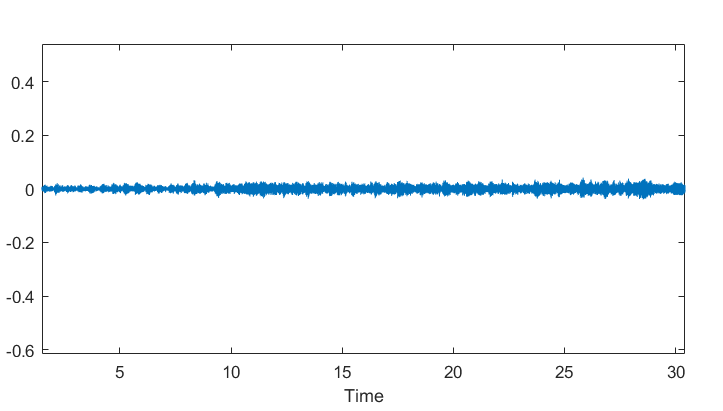 | 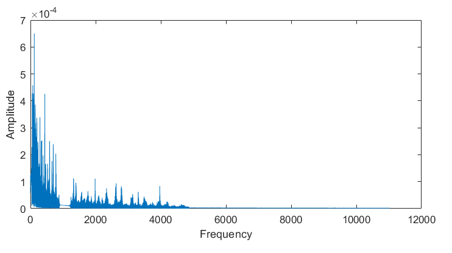 |

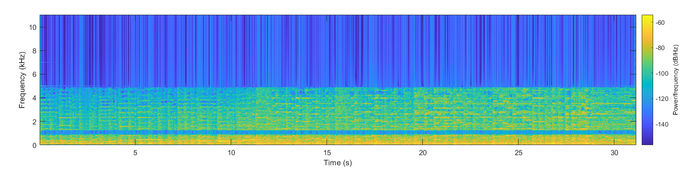

## Speed variations

Changing the playback sample rate creates faster and slower versions of the cleaned recording while preserving the underlying samples.

### Two-times speed

| Waveform | Amplitude spectrum |
| --- | --- |
| 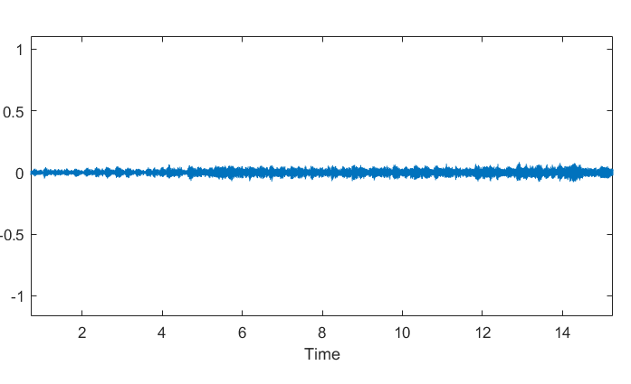 | 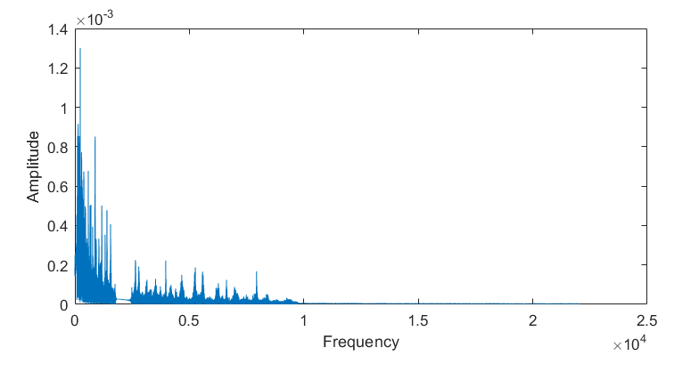 |

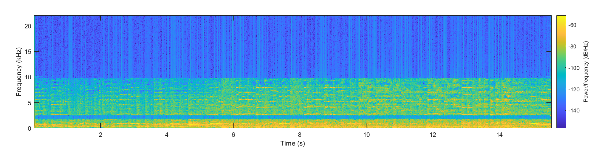

### Half speed

| Waveform | Amplitude spectrum |
| --- | --- |
| 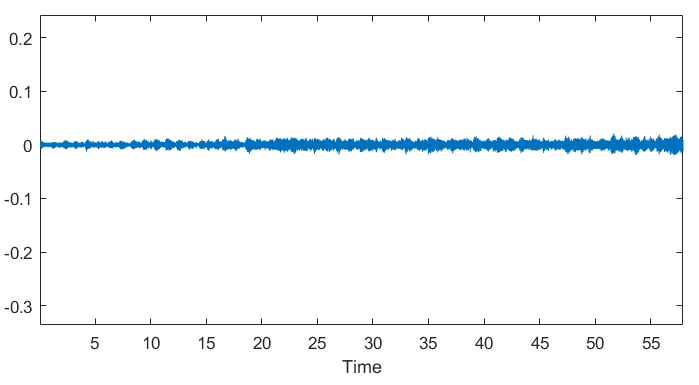 | 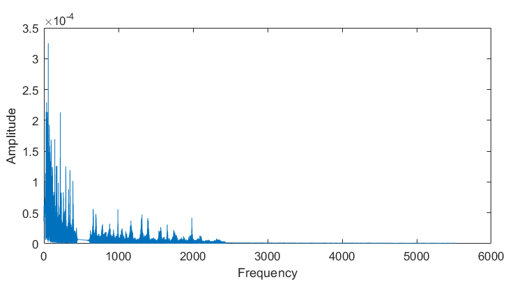 |

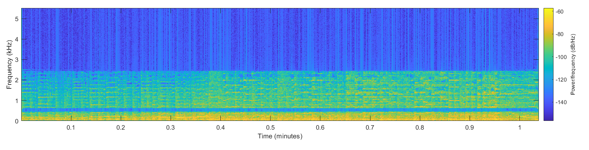

## Reversed signal

| Waveform | Amplitude spectrum |
| --- | --- |
| 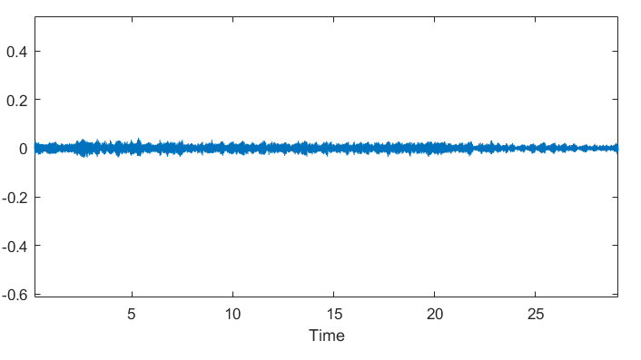 | 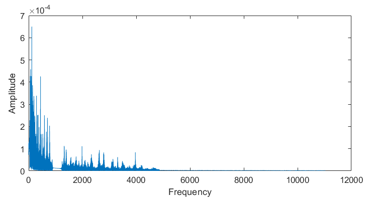 |

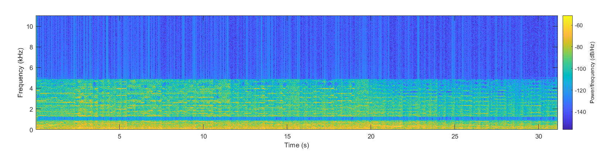

## Frequency-domain mix

The cleaned, fast, slow, and reversed signals are aligned to a common sample rate, padded to the same length, transformed with the FFT, combined, and reconstructed using the inverse FFT.

| Mixed amplitude spectrum | Mixed spectrogram |
| --- | --- |
| 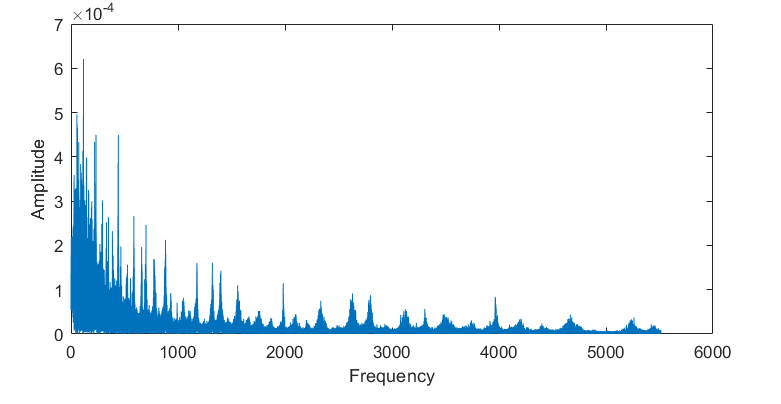 | 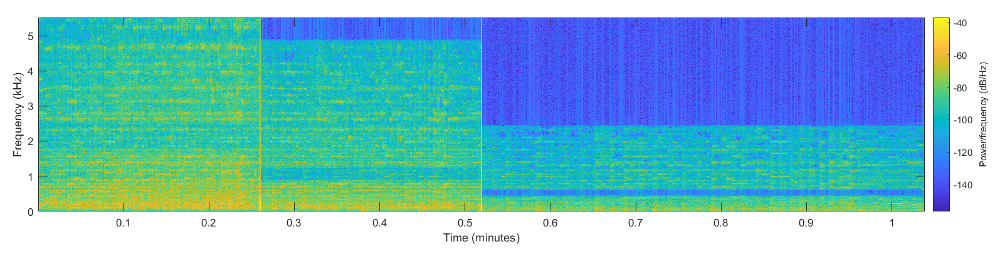 |
