# Image Processing with MATLAB

This Signals and Systems course project explores image processing in both the spatial and frequency domains. 

## Project overview

The project implements the main operations directly instead of relying on ready-made convolution or pooling functions:

- 2D convolution with configurable stride and `valid` or `same` padding
- Edge enhancement and horizontal/vertical edge detection
- Multi-channel feature-map construction
- Gaussian blur and large-edge enhancement in a second layer
- Max pooling
- Grayscale conversion and 2D Fourier analysis
- Low-pass, high-pass, band-pass, and Laplacian frequency filters

## Spatial-domain results

The input is resized to 600 x 600 pixels before the filters are applied.

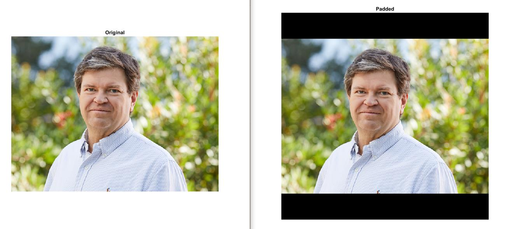

| Edge enhancement | Horizontal edges | Vertical edges |
| --- | --- | --- |
| 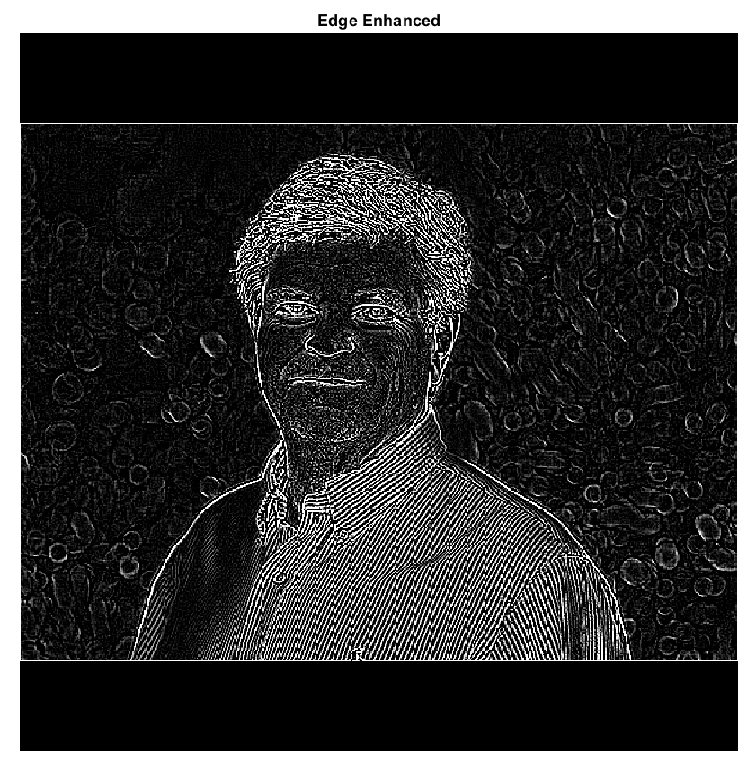 | 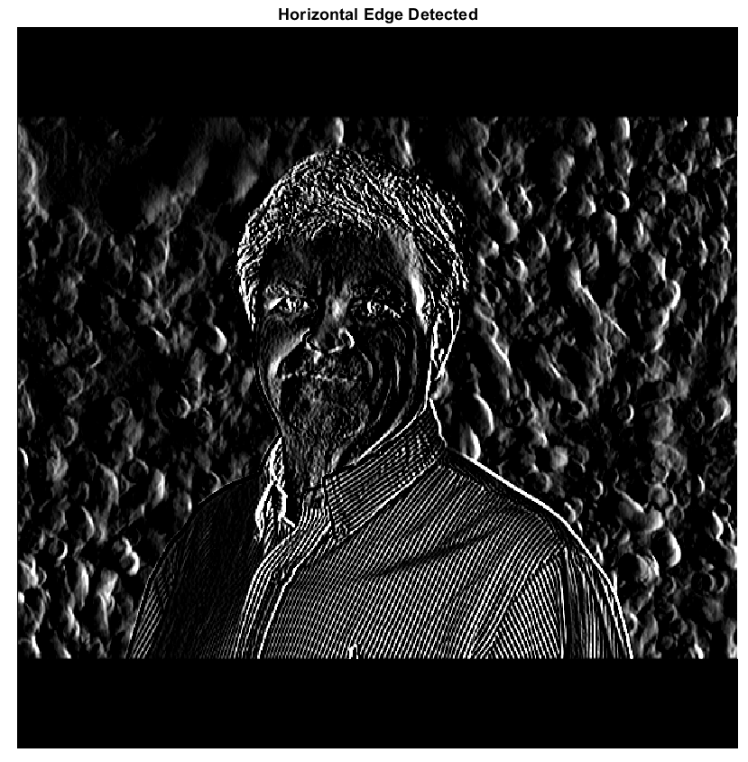 | 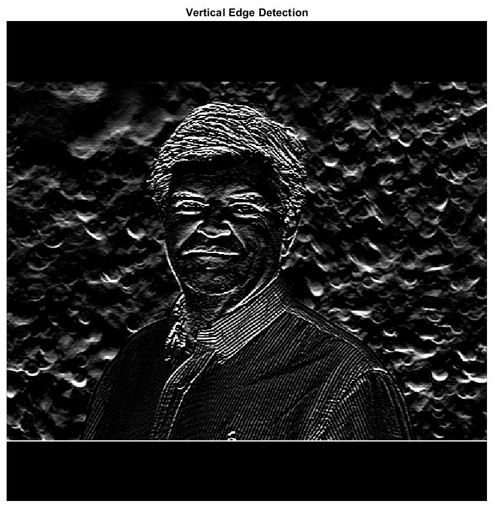 |

### Feature maps

| First layer | Second layer | Max pooling |
| --- | --- | --- |
| 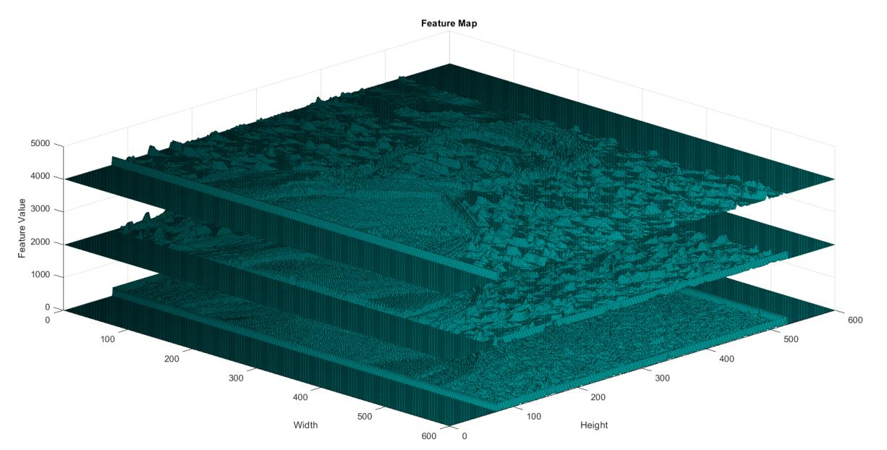 | 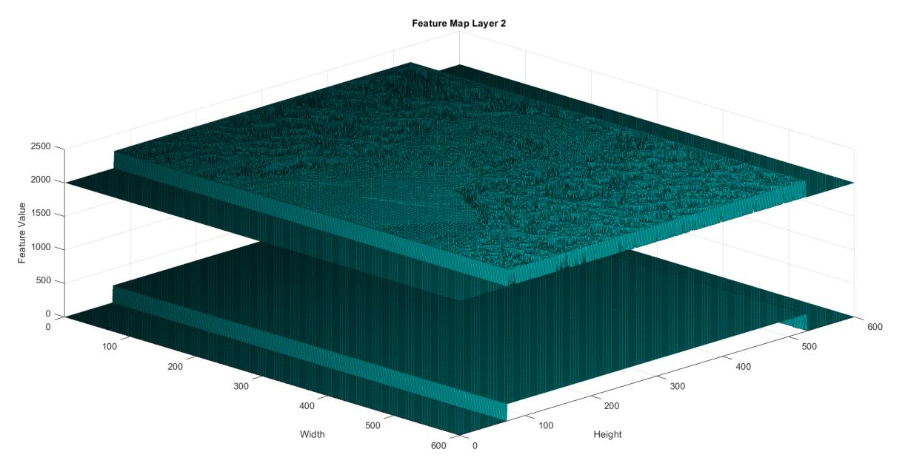 | 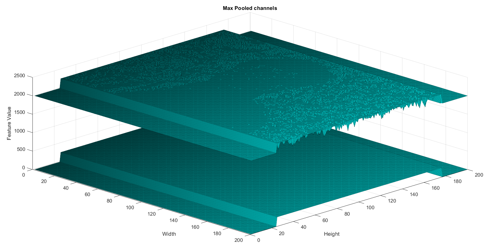 |

The second layer applies a Gaussian blur and a larger edge-enhancement kernel to the first feature map.

| Gaussian blur | Large-edge enhancement |
| --- | --- |
| 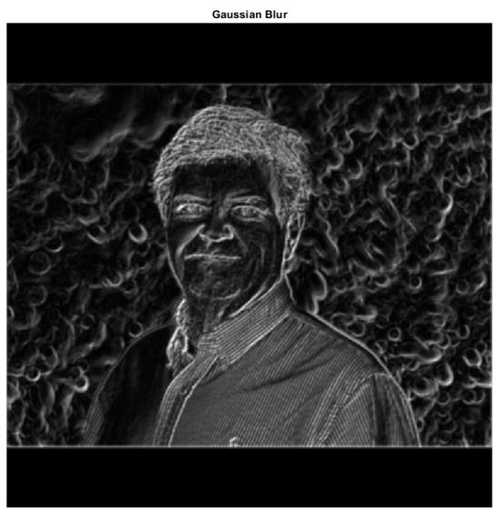 | 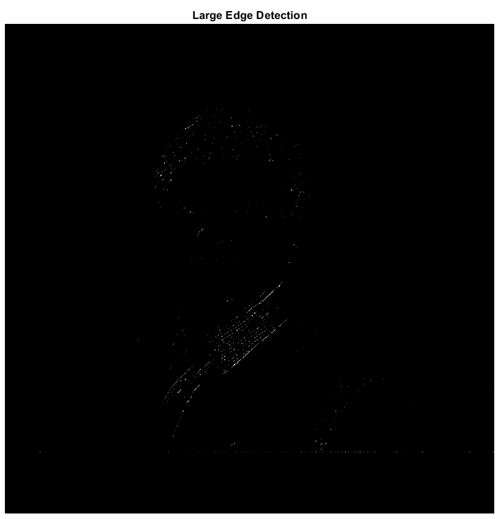 |

## Frequency-domain results

The grayscale image is transformed with a 2D FFT. Its magnitude and phase spectra are then inspected before applying four frequency-domain filters.

| Grayscale input | Magnitude and phase spectra |
| --- | --- |
| 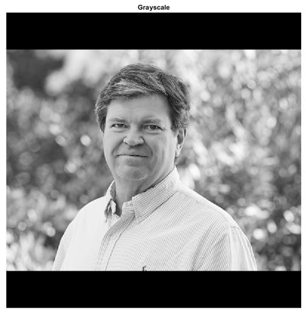 | 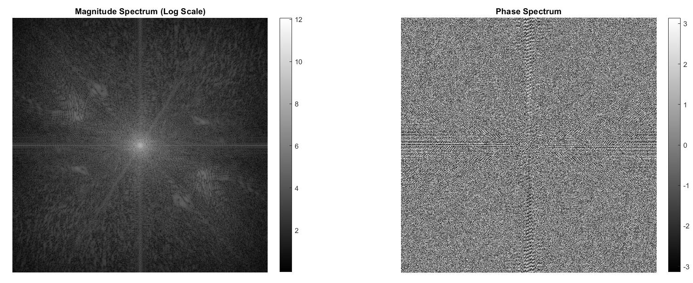 |

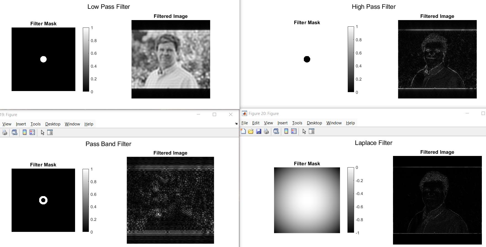

